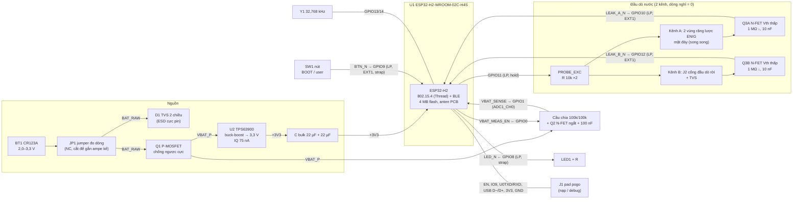

# Giai đoạn 2 — Sơ đồ khối & gán chân GPIO

> **Trạng thái:** ĐÃ CHỐT (2026-11-12), xem [§10](#10-quyết-định-đã-chốt-trước-gđ3). Đầu vào là các quyết định đã chốt ở [GĐ1 §9](01-yeu-cau-va-ngan-sach-dong.md#9-quyết-định-đã-chốt): CR123A, ESP32-H2-WROOM-02C-H4S, không buzzer, 2 kênh đầu dò.
> Đã đối chiếu với ESP32-H2 Datasheet v1.3, ESP32-H2-WROOM-02C Datasheet v1.2 (bảng 2, hình 2/4/5) và ESP32-H2 Hardware Design Guidelines.
> Ký hiệu linh kiện (U1, Q1…) ở đây là tạm thời; GĐ3 sẽ giữ nguyên nếu không có lý do đổi.

## 1. Sơ đồ khối



Bản ASCII rút gọn, dùng khi xem file thô:

```
            JP1       Q1 PFET             U2 TPS63900          +3V3
 CR123A ──┤jump├──┬──┤ reverse  ├─VBAT_P─┤ buck-boost  ├──┬──────────────┬──────────────────────┐
 2.0–3.3V         │  │ polarity │   │    │ 3.3 V 75 nA │  │22µF          │ U1 ESP32-H2-WROOM-02C │
             D1 TVS┴  └──────────┘   │    └─────────────┘  │              │                       │
                                     ├─100k─┬─VBAT_SENSE───┼──────────────┤GPIO1 (ADC1_CH0)       │
                                     │     100k  100nF     │              │                       │
                                     │      Q2 ◄───────────┼──────────────┤GPIO0  VBAT_MEAS_EN    │
                                     │                     │              │                       │
                   comb A (đáy) ◄─10k┬─────────────────────┼──────────────┤GPIO11 PROBE_EXC (LP)  │
                   J2.1 (rời)   ◄─10k┘                     │              │                       │
       comb A' ─10k─┬─G Q3A  D──────────────── LEAK_A_N ───┼──470k──┬─────┤GPIO10 (LP, EXT1)      │
                  1M,10nF                                  │              │                       │
       J2.2  ──10k──┬─G Q3B  D──────────────── LEAK_B_N ───┼──470k──┴─────┤GPIO12 (LP, EXT1)      │
                  1M,10nF                                  │              │                       │
       SW1 ─────────────────────────────────── BTN_N ──────┼──10k─────────┤GPIO9  (LP, EXT1, BOOT)│
       LED1+1k ◄────────────────────────────── LED_N ──────┼──47k─────────┤GPIO8  (LP, strap)     │
       Y1 32.768 kHz ──────────────────────────────────────┼──────────────┤GPIO13/14              │
       J1 pogo: GND 3V3 EN IO9 TXD0 RXD0 D− D+ ────────────┴──────────────┤EN,23,24,26,27        │
                                                                          └───────────────────────┘
```

## 2. Cây nguồn và dòng theo khối

| Khối | Ngủ (điển hình) | Đỉnh | Ghi chú |
|---|---|---|---|
| BT1 CR123A → Q1 | 32 µA phía pin | ≈ 80–100 mA (TX +9 dBm, pin 2,2–2,8 V) | Ở +20 dBm có thể tới ≈ 230 mA khi pin yếu. CR123A chịu xung này tốt. |
| U2 TPS63900 | IQ 75 nA | > 400 mA ra khi VIN ≥ 2 V | Hiệu suất ≈ 91 % ở tải ngủ, ≈ 92 % ở tải TX. |
| U1 module | 25 µA (light-sleep, TOP power-down) | 60 mA (TX +9 dBm), 25 mA (RX) | Chip cần nguồn 3,3 V ≥ 350 mA theo HW guideline; U2 đáp ứng. |
| Cầu chia đo pin | 0 (Q2 tắt) | 16,5 µA trong ≈ 30 ms, 4 lần/ngày | Không đáng kể. |
| Đầu dò A/B | 0 khi khô | ≤ 7 µA/kênh lúc vừa ướt (pull-up 470 k) và ≤ 3,3 µA qua nước | Sau ≤ 1 s, firmware bỏ phân cực và chuyển sang đo xung. |
| LED1 | 0 | ≈ 1,4 mA khi sáng (+70 µA qua pull-up) | Chỉ nháy khi có sự kiện. |
| Nút SW1 | 0 | 330 µA khi đang nhấn (10 k) | |
| ESD/TVS, MOSFET, MLCC | ≤ 0,5 µA (ngân sách "board" ở GĐ1) | — | Chọn TVS dòng rò thấp ở 3,3 V. Không dùng tụ tantalum (rò ~0,01 CV). |

**Ghi chú về tụ:** tổng MLCC bulk nên vừa phải: 10 µF ở VIN, 22 µF ở VOUT, 22 µF sát module. Datasheet MLCC thường chỉ đảm bảo IR ≥ 100 Ω·F, tức là với 100 µF dòng rò tối đa *theo spec* có thể tới µA. Giá trị typ thấp hơn nhiều, nhưng không nên phung phí.

## 3. Bảng gán chân (ESP32-H2-WROOM-02C)

Chân module theo hình 2 của datasheet module: chân 1–9 nằm cạnh trái, 10–19 cạnh dưới, 20–28 cạnh phải, 29 là EPAD (GND). Anten ở phía trên.

| Chân module | GPIO | Net | Hướng | Mức tích cực | Trạng thái lúc reset (DS bảng 2-1) | Kéo ngoài | Khi ngủ (light-sleep TOP PD / deep-sleep) | Ghi chú |
|---|---|---|---|---|---|---|---|---|
| 1 | — | **+3V3** | Nguồn | — | — | — | — | Thêm 22 µF + 0,1 µF sát chân. Module đã có 10 µF/1 µF/0,1 µF bên trong. |
| 2 | EN | **EN** | Vào | Cao = chạy | — | 10 kΩ lên 3V3, 1 µF xuống GND | Luôn cao | RC theo hình 5 của DS module. Có pad pogo. |
| 3 | GPIO4 | *(dự phòng)* | — | — | thả nổi | — | Firmware cấu hình pull-down | ADC1_CH3 / MTCK. Ra test pad. |
| 4 | GPIO5 | *(dự phòng)* | — | — | thả nổi | — | Firmware cấu hình pull-down | ADC1_CH4 / MTDI. Ra test pad. |
| 5 | **GPIO10** | **LEAK_A_N** | Vào | Thấp = ướt | thả nổi | **470 kΩ lên 3V3** | Ngõ vào LP, **EXT1 ANY_LOW** | Drain Q3A, kênh A (điện cực đáy). |
| 6 | **GPIO11** | **PROBE_EXC** | Ra | Cao = phân cực | thả nổi (đầu dò không phân cực, an toàn) | — | **Hold**: 1 khi khô (armed), 0 khi ướt hoặc đang đo xung | Qua 2 × 10 kΩ tới kênh A và J2.1. |
| 7 | **GPIO8** | **LED_N** | Ra | Thấp = sáng | IE, không pull (**strap**) | **47 kΩ lên 3V3** | Hi-Z, pull-up giữ LED tắt | Pull-up đảm bảo GPIO8 = 1 khi reset, đúng điều kiện download boot. |
| 8 | **GPIO9** | **BTN_N** | Vào | Thấp = nhấn | IE + WPU (**strap BOOT**) | **10 kΩ lên 3V3**, tụ 1 nF | Ngõ vào LP, **EXT1 ANY_LOW** | Giữ nút khi reset sẽ vào download mode. HW guideline: không gắn tụ lớn ở GPIO9. |
| 9 | — | GND | | | | | | |
| 10 | **GPIO12** | **LEAK_B_N** | Vào | Thấp = ướt | thả nổi | **470 kΩ lên 3V3** | Ngõ vào LP, **EXT1 ANY_LOW** | Drain Q3B, kênh B (đầu dò rời J2). |
| 11 | GPIO13 | **XTAL32K_P** | Analog | — | — | — | Dao động | Y1 32,768 kHz, ESR ≤ 70 kΩ, tụ tải theo CL (hình 5 dùng 12 pF). |
| 12 | GPIO14 | **XTAL32K_N** | Analog | — | — | — | Dao động | |
| 13 | — | GND | | | | | | |
| 14 | VBAT (module) | **+3V3** | Nguồn | — | — | — | — | Trong module đã nối 3V3 qua R2 = 0 Ω. **Không** nối CR123A vào đây vì chân này cần 3,0–3,6 V. |
| 15 | GPIO22 | *(dự phòng)* | — | — | thả nổi | — | Firmware cấu hình pull-down | Ra test pad. Dành cho LED màu thứ 2 nếu chọn LED 2 màu. |
| 16–19 | — | NC | | | | | | |
| 20 | GPIO25 | *(không nối)* | — | — | IE (**strap JTAG**) | — | — | Chỉ có tác dụng khi eFuse `STRAP_JTAG_SEL_ENABLE` = 1. **Không đốt eFuse này.** |
| 21 | GPIO23 | **U0RXD** | Vào | — | IE + WPU | — | Hi-Z | Pad pogo RXD0. |
| 22 | GPIO24 | **U0TXD** | Ra | — | IE + WPU | — | Hi-Z | Pad pogo TXD0. Module đã có R 499 Ω nối tiếp bên trong. ROM log in ra chân này khi boot. |
| 23 | GPIO26 | **USB_DN** | I/O | — | IE | 22 Ω nối tiếp | Hi-Z | Pad pogo. Tụ xuống GND để DNP theo HW guideline. |
| 24 | GPIO27 | **USB_DP** | I/O | — | IE + USB_PU | 22 Ω nối tiếp | Hi-Z | Pull-up USB nội không tốn dòng khi pad bỏ trống. |
| 25 | GPIO3 | *(dự phòng)* | — | — | IE | — | Firmware cấu hình pull-down | ADC1_CH2 / MTDO. |
| 26 | GPIO2 | *(dự phòng)* | — | — | IE | — | Firmware cấu hình pull-down | ADC1_CH1 / MTMS. |
| 27 | **GPIO1** | **VBAT_SENSE** | Analog | — | thả nổi | 100 nF xuống GND | Hi-Z (bằng VBAT_P qua 100 k, không có dòng) | **ADC1_CH0, ATTEN2 (0–1,9 V)**. Tỉ lệ cầu chia 1:2 nên tối đa 1,65 V. |
| 28 | **GPIO0** | **VBAT_MEAS_EN** | Ra | Cao = đo | thả nổi | **1 MΩ xuống GND** (gate Q2) | Hi-Z, pull-down giữ Q2 tắt | |
| 29 | — | GND (EPAD) | | | | | | Nối GND carrier bằng nhiều via. |

**Thống kê:** dùng 7/7 LP GPIO (GPIO8–14), 2/12 GPIO số cho chức năng, 4 GPIO số cho pad nạp. Còn dư 6 GPIO (GPIO2–5, 22, 25), trong đó 4 chân có ADC.

## 4. Kiểm tra strapping (DS v1.3 §3, HW guideline "Strapping Pins")

| Strap | Yêu cầu | Mạch của mình | Kết quả |
|---|---|---|---|
| GPIO9 | 1 → SPI boot; 0 (khi GPIO8 = 1) → download | 10 kΩ lên 3V3 (cộng WPU nội 45 kΩ). Nhấn SW1 hoặc jig kéo xuống thì vào download | ✔ Theo đúng hình 5 (R8 10 kΩ). τ = 10 kΩ‖45 kΩ × 1 nF ≈ 8 µs, rất nhỏ so với t_H = 3 ms. |
| GPIO8 | Không quan trọng khi SPI boot; **phải = 1** khi download boot | 47 kΩ lên 3V3. LED nối 3V3 → R → LED → GPIO8 nên khi chân hi-Z cũng chỉ bị kéo lên | ✔ Không có đường nào kéo GPIO8 xuống lúc reset. |
| GPIO25 | Bị bỏ qua khi eFuse mặc định | Không nối | ✔ Ghi rõ trong quy trình sản xuất: không đốt `EFUSE_STRAP_JTAG_SEL_ENABLE`. |
| CHIP_EN | Không thả nổi; τ đủ dài so với t_STBL 50 µs | Ngoài module có 10 kΩ / 1 µF (τ ≈ 10 ms) | ✔ TPS63900 lên 3,3 V trong vài ms (trễ 1,5 ms + soft-start). EN lên sau đó, nên strap được đọc khi nguồn đã ổn định. |

## 5. Đánh thức và trạng thái khi ngủ

- **Nguồn đánh thức EXT1:** mask = `BIT(9) | BIT(10) | BIT(12)`, chế độ `ESP_EXT1_WAKEUP_ANY_LOW`. Cả ba tín hiệu đều tích cực mức thấp.
  - EXT1 dùng được trong **cả light-sleep có TOP power-down lẫn deep-sleep**.
  - Ngược lại, `gpio_wakeup_enable()` bị vô hiệu khi bật `PM_POWER_DOWN_PERIPHERAL_IN_LIGHT_SLEEP`.
- **Pull nội không có hiệu lực khi LP/RTC peripheral tắt.** Vì vậy cả ba ngõ đánh thức đều có pull-up ngoài: 10 kΩ cho nút, 470 kΩ cho hai kênh đầu dò. Có pull-up ngoài thì firmware không phụ thuộc vào hold của pull nội.
- **Ngõ ra digital mất trạng thái khi ngủ.** Hai ngõ ra digital (VBAT_MEAS_EN, và LED màu 2 nếu có) đều có điện trở kéo về trạng thái **tắt**. PROBE_EXC là LP GPIO nên giữ được mức bằng hold.
- **Chân không dùng:** HW guideline yêu cầu không để chân hi-Z không có pull, vì có thể tốn dòng. Firmware sẽ cấu hình GPIO2–5, 22, 25 thành input tắt IE có pull-down, hoặc bật `CONFIG_PM_SLP_DISABLE_GPIO`. Sẽ xác minh bằng đo dòng ở GĐ6.

### 5.1 Máy trạng thái đầu dò (tóm tắt, chi tiết ở GĐ5)

```
           ┌──────────────── khô liên tục ≥ 30 s ────────────────┐
           ▼                                                      │
  ┌──────────────────┐ EXT1: LEAK_x_N=0 ┌──────────────┐ 3 mẫu ướt ┌──────────────────────────┐
  │ ARMED_DRY        │ ───────────────► │ CONFIRMING   │ ────────► │ WET                      │
  │ PROBE_EXC=1(hold)│                  │ mẫu 100 ms   │           │ báo StateValue=TRUE      │
  │ ngủ, 0 dòng đầu dò│ ◄─────────────── │              │           │ PROBE_EXC=0 (bỏ phân cực)│
  └──────────────────┘   mẫu khô (giả)  └──────────────┘           │ đo xung: EXC=1 trong 2 ms│
                                                                   │ mỗi 10 s, đọc A và B     │
                                                                   └──────────────────────────┘
```

## 6. Các giao tiếp ra ngoài

| Giao tiếp | Đề xuất | Chân / net |
|---|---|---|
| J1 pad nạp | 8 pad hàng thẳng pitch 2,54 mm cho jig pogo; nạp khi đã tháo pin, jig cấp 3,3 V | 1 GND · 2 +3V3 · 3 EN · 4 IO9/BOOT · 5 TXD0 (GPIO24) · 6 RXD0 (GPIO23) · 7 USB_DN (GPIO26) · 8 USB_DP (GPIO27) |
| J2 đầu dò rời | Đầu nối 2 chân (loại sẽ chốt ở câu hỏi trước GĐ3) | 1 = EXC_B (qua 10 kΩ) · 2 = SNS_B |
| Điện cực kênh A | 2 vùng răng lược ENIG ở 2 đầu mặt đáy, nối song song | EXC_A / SNS_A |
| JP1 | Jumper hàn, mặc định nối, nằm trên đường pin. Cắt ra để đo dòng (GĐ6) | BAT_RAW |
| Test pad | VBAT_P, +3V3, PROBE_EXC, LEAK_A_N, LEAK_B_N, GPIO4/5/22 | |

## 7. Header chân cho firmware (bản nháp, sẽ đưa vào `firmware/main/board_pins.h` ở GĐ5)

```c
#pragma once
#include "driver/gpio.h"
#include "hal/adc_types.h"

/* h2-watterleak-sensor rev A — ESP32-H2-WROOM-02C-H4S */
#define PIN_VBAT_MEAS_EN   GPIO_NUM_0   /* out, active-high, ext. 1 MΩ pull-down on Q2 gate   */
#define PIN_VBAT_SENSE     GPIO_NUM_1   /* ADC1_CH0, divider 100k/100k (×2), 100 nF            */
#define PIN_LED_N          GPIO_NUM_8   /* LP, out, active-low, ext. 47 kΩ pull-up (strap)     */
#define PIN_BUTTON_N       GPIO_NUM_9   /* LP, in, active-low, ext. 10 kΩ pull-up (BOOT strap) */
#define PIN_LEAK_A_N       GPIO_NUM_10  /* LP, in, active-low, ext. 470 kΩ pull-up — bottom combs */
#define PIN_PROBE_EXC      GPIO_NUM_11  /* LP, out, 1 = probes biased (armed); hold in sleep    */
#define PIN_LEAK_B_N       GPIO_NUM_12  /* LP, in, active-low, ext. 470 kΩ pull-up — remote probe */
/* GPIO13/14: 32.768 kHz crystal -> CONFIG_RTC_CLK_SRC_EXT_CRYS=y                              */

#define VBAT_ADC_UNIT      ADC_UNIT_1
#define VBAT_ADC_CHANNEL   ADC_CHANNEL_0
#define VBAT_ADC_ATTEN     ADC_ATTEN_DB_6      /* ATTEN2: 0..1.9 V on ESP32-H2 */
#define VBAT_DIVIDER_NUM   2
#define VBAT_SETTLE_MS     30                  /* ≈ 6 τ, τ = (100k‖100k)·100 nF = 5 ms */

#define WAKE_EXT1_MASK     ((1ULL << PIN_BUTTON_N) | (1ULL << PIN_LEAK_A_N) | (1ULL << PIN_LEAK_B_N))
```

> Trong ESP-IDF, `ADC_ATTEN_DB_6` tương ứng ATTEN2. Giá trị dải đo chính thức (0–1900 mV) lấy từ DS bảng 5-5. GĐ5 sẽ dùng ADC calibration (curve fitting) của IDF.

## 8. Quyết định đã đưa vào ở GĐ2

1. **Thêm RC cho EN (10 kΩ / 1 µF) và pull-up 10 kΩ cho GPIO9 ngoài module.**
   - Hình 4 (sơ đồ bên trong module) không có RC trên EN, dù phần text nói RC "đã có trong module".
   - Hình 5 (mạch ngoại vi) lại đặt R1/C3 trên EN và R8 10 kΩ trên IO9.
   - Lắp thêm ở ngoài vô hại nếu module đã có, và an toàn nếu module không có.
2. **Pull-up kênh đầu dò là 470 kΩ (không phải 1 MΩ).** Nếu MOSFET rò 1 µA (giới hạn spec xấu nhất), chân vẫn ở 2,8 V, cao hơn ngưỡng V_IH = 0,75 × VDD = 2,48 V.
3. **Cầu chia 100 kΩ / 100 kΩ, tụ 100 nF.** HW guideline yêu cầu 0,1 µF ở chân ADC. Điện trở nhỏ giúp sai số do dòng rò chân (≤ 50 nA) chỉ khoảng 2,5 mV.
4. **Jumper đo dòng JP1 trên đường pin**, để đo sàn ngủ ở GĐ6 mà không phải cắt mạch.
5. ~~Supervisor reset tuỳ chọn~~: đã bỏ, xem §10.

## 9. Câu hỏi trước GĐ3

Các câu hỏi này được hỏi trực tiếp trong phiên làm việc. Câu trả lời sẽ ghi lại ở [§10](#10-quyết-định-đã-chốt-trước-gđ3).

1. Phiên bản KiCad để mình xuất file (8 hay 9).
2. Loại đầu nối J2 cho đầu dò rời.
3. Phương án lắp ráp: JLCPCB lắp SMD hay tự hàn tay. Quyết định này ảnh hưởng cỡ linh kiện (0402 hay 0603) và việc chọn linh kiện LCSC Basic/Extended.
4. LED: 1 màu hay LED 2 màu trong cùng 1 vỏ (dùng thêm GPIO22).

## 10. Quyết định đã chốt trước GĐ3

| # | Câu hỏi | Quyết định (2026-11-12) | Hệ quả cho GĐ3–4 |
|---|---|---|---|
| 1 | Phiên bản KiCad | **KiCad 9** | Sinh file định dạng KiCad 9. Chạy ERC/DRC và xuất Gerber/BOM/CPL bằng `kicad-cli` 9. |
| 2 | Đầu nối J2 | **JST-PH 2.0 mm**, 2 chân | Chọn loại cắm ngang THT (S2B-PH-K-S) để dây ra cạnh vỏ và dễ hàn tay. |
| 3 | Lắp ráp | **Tự hàn tay toàn bộ** | Thụ động **0603** (tụ 22 µF dùng 0805). MOSFET **SOT-23 đơn**. TVS **SOD-323**. Đế CR123A và JST loại **THT**. TPS63900 (WSON-10, chỉ có vỏ này) cần khò nóng hoặc bếp hàn: footprint kéo dài pad và đặt via ở pad nhiệt để hàn từ mặt dưới. EPAD của module cũng có lỗ hàn từ mặt dưới. BOM vẫn kèm mã LCSC để đặt linh kiện; CPL vẫn xuất để dùng nếu sau này muốn cho JLCPCB lắp. |
| 4 | LED | **1 LED đỏ/cam** (AlInGaP, Vf ≈ 2 V) | GPIO22 vẫn để dự phòng. |
| — | Supervisor reset | **Bỏ** (không cả footprint DNP) | TPS63900 tắt đột ngột ở UVLO, không có sườn xuống chậm. EN đã có RC. Firmware dùng brown-out detector và backoff. |
