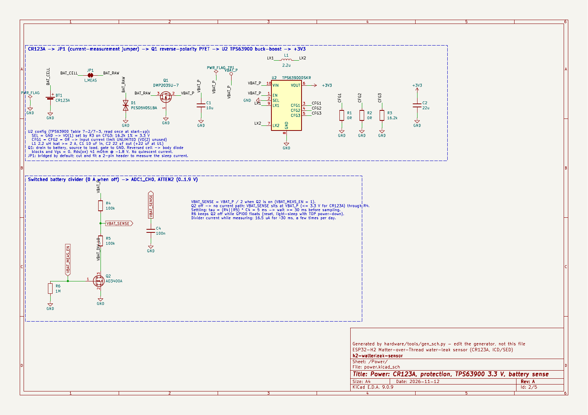
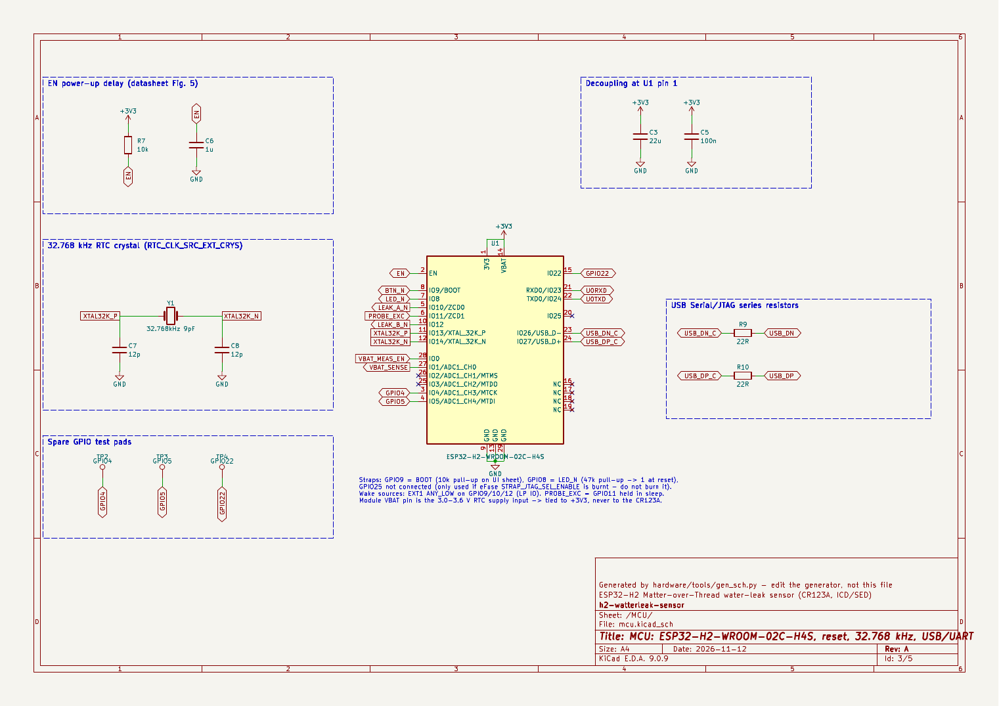
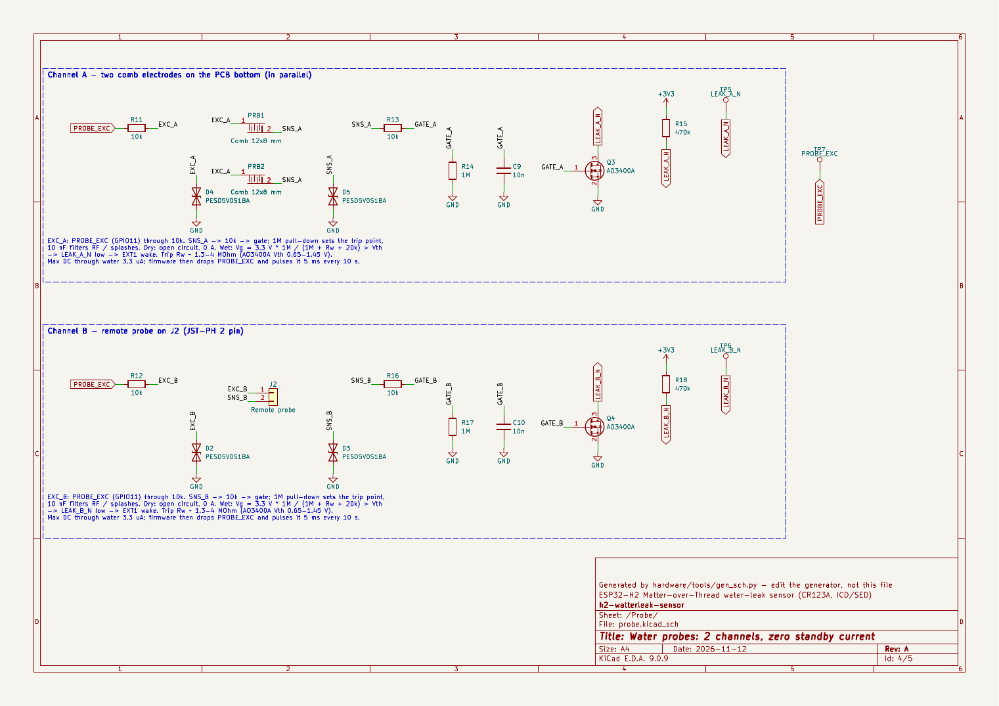
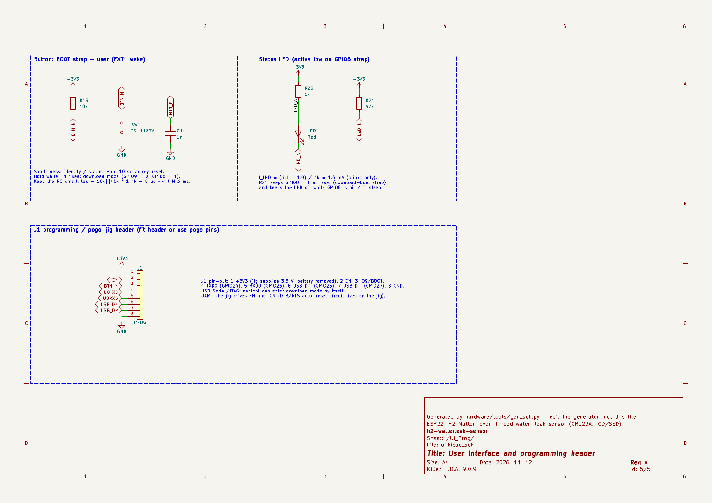

# Giai đoạn 3 — Sơ đồ nguyên lý (KiCad 9)

> **Trạng thái:** HOÀN TẤT.
> - **ERC của KiCad 9.0.9: 0 lỗi, 0 cảnh báo** ở mọi mức độ (`kicad-cli sch erc --severity-all`).
> - Netlist đã được soát từng net, đối chiếu với bảng gán chân ở [GĐ2](02-so-do-khoi-va-gan-chan.md).
> - Trước khi sang GĐ4 (layout) còn vài điểm cơ khí cần chốt, xem [§9](#9-câu-hỏi-trước-gđ4).

## 0. Tệp và cách tái tạo

| Nội dung | Đường dẫn |
|---|---|
| Project KiCad 9: 1 trang gốc + 4 trang khối | [`hardware/h2-leak-sensor/`](../hardware/h2-leak-sensor/) (mở `h2-leak-sensor.kicad_pro`) |
| Bản PDF của sơ đồ | [`hardware/h2-leak-sensor/h2-leak-sensor_schematic.pdf`](../hardware/h2-leak-sensor/h2-leak-sensor_schematic.pdf) |
| Ảnh xem nhanh | [`docs/img/sch/`](img/sch/) (sheet-1 … sheet-5) |
| Thư viện riêng (symbol + footprint) | `hardware/h2-leak-sensor/lib/h2leak.kicad_sym`, `lib/h2leak.pretty/` |
| BOM (gộp theo giá trị) | [`hardware/h2-leak-sensor/bom/h2-leak-sensor_bom.csv`](../hardware/h2-leak-sensor/bom/h2-leak-sensor_bom.csv) |
| Bộ sinh | `hardware/tools/gen_lib.py`, `hardware/tools/gen_sch.py` |

Sơ đồ được **sinh bằng script**, nên mỗi lần sửa đều có thể chạy lại và kiểm tra lại bằng ERC:

```sh
python3 hardware/tools/gen_lib.py && python3 hardware/tools/gen_sch.py
cd hardware/h2-leak-sensor && kicad-cli sch erc --severity-all h2-leak-sensor.kicad_sch
```

> Nếu muốn chỉnh tay trong KiCad 9 thì cứ chỉnh. Lưu ý: chạy lại `gen_sch.py` sẽ ghi đè các thay đổi đó.
> Khi đã bắt đầu sửa tay, coi bản KiCad là nguồn chính và không chạy generator nữa.

Kiểu vẽ: mỗi chân có một đoạn dây ngắn kết thúc bằng một trong các thứ sau:
- nhãn net,
- nhãn global (với net đi qua nhiều trang),
- ký hiệu nguồn `+3V3` / `GND`,
- cờ no-connect.

Một vài cặp linh kiện nằm thẳng hàng được nối dây trực tiếp: cầu chia đo pin, thạch anh, LED.

## 1. Cấu trúc sơ đồ

| Trang | Khối | Linh kiện |
|---|---|---|
| 1 `/` | Trang gốc: 4 sheet và tóm tắt | — |
| 2 `/Power/` | Pin, chống ngược cực, TPS63900, đo pin | BT1, JP1, D1, Q1, C1, U2, L1, R1–R3, C2, R4–R6, C4, Q2, TP1 |
| 3 `/MCU/` | Module, RC cho EN, thạch anh 32 kHz, điện trở USB, test pad | U1, R7, C6, C3, C5, Y1, C7, C8, R9, R10, TP2–TP4 |
| 4 `/Probe/` | Đầu dò kênh A (2 điện cực đáy) và kênh B (J2) | R11–R18, C9, C10, Q3, Q4, D2–D5, PRB1, PRB2, J2, TP5–TP7 |
| 5 `/UI_Prog/` | Nút BOOT/user, LED, header nạp | SW1, R19, C11, R20, LED1, R21, J1 |

Các net đi qua nhiều trang dùng nhãn global: `EN`, `BTN_N`, `LED_N`, `LEAK_A_N`, `LEAK_B_N`, `PROBE_EXC`, `VBAT_SENSE`, `VBAT_MEAS_EN`, `U0TXD/RXD`, `USB_DN/DP`.

## 2. Khối nguồn



| Linh kiện | Giá trị | Tính toán / lý do |
|---|---|---|
| U2 TPS63900DSKR | VO = 3,3 V | `SEL = GND` chọn VO(1). R3 = 16,2 kΩ 1 % trên CFG3 cho 3,3 V (TI bảng 7-3). R1 = R2 = 0 Ω trên CFG1/CFG2 cho **giới hạn dòng vào = Unlimited** (bảng 7-2). Các chân CFG chỉ được đọc một lần lúc khởi động. `EN` nối VBAT_P nên luôn chạy. |
| L1 Sunlord WPN4020H2R2MT | 2,2 µH, 48 mΩ, 4×4 mm | TPS63900 giới hạn dòng đỉnh qua switch ở 1,45 A typ / 1,6 A max. Cuộn cảm chịu ≥ 4,3 A (Isat/Irms theo LCSC), dư nhiều. Vỏ 4×4 mm dễ hàn tay hơn bản 2520 dùng trong datasheet. |
| C1 | 10 µF 0603 X5R | Tụ vào theo TI 8.2.2.4. CR123A có nội trở thấp nên không cần tụ bulk lớn. |
| C2 + C3 | 22 µF 0805 25 V X5R mỗi tụ | 22 µF ra theo TI. Thêm 22 µF sát chân 1 của module (HW guideline: 10 µF ở lối vào chip). Chọn tụ 25 V để giảm suy hao điện dung do DC bias ở 3,3 V. |
| Q1 DMP2035U-7 | P-MOSFET 20 V | Drain nối pin, source nối tải, gate nối GND. Rds(on) 41 mΩ @ V_GS = −1,8 V, nên sụt chỉ **4 mV ở 100 mA** và 9 mV ở 230 mA (TX +20 dBm khi pin yếu). Khi lắp ngược pin, V_GS = 0 và diode thân phân cực ngược, nên mạch được bảo vệ. Không có dòng tĩnh. |
| D1 PESD5V0S1BA | TVS 2 chiều 5 V | ESD ở cực pin. Loại 2 chiều nên không dẫn khi pin lắp ngược. I_RM 5 nA. |
| JP1 | Jumper hàn, nối sẵn | Cắt ra rồi hàn header 2 chân để đo dòng ngủ ở GĐ6. |
| TP1, #FLG01/02 | — | TP1 là test pad đo VBAT_P. Hai PWR_FLAG chỉ phục vụ ERC. |
| R4, R5, C4, Q2, R6 | 100 k / 100 k / 100 nF / AO3400A / 1 M | VBAT_SENSE = VBAT_P/2 khi `VBAT_MEAS_EN = 1`. Với CR123A, VBAT_SENSE nằm trong 1,0–1,65 V, vừa dải **ATTEN2 (0–1,9 V, ±12 mV)**. τ = 50 kΩ × 100 nF = 5 ms, nên phải đợi ≥ 30 ms rồi mới đọc. Khi Q2 tắt thì không có đường dòng (0 A). Q2 có V_GS(th) ≤ 1,45 V nên dẫn hoàn toàn ở 3,3 V. R6 giữ Q2 tắt khi GPIO0 thả nổi. |

**Sai số đo pin:**
- ADC ±12 mV ở chân, tức ±24 mV ở pin.
- Điện trở 1 % gây thêm ±1 % tỉ lệ, tức ±33 mV ở 3,3 V.
- Tổng xấu nhất khoảng ±60 mV. Đủ cho ngưỡng Warning/Critical của CR123A vì đường xả rất phẳng, nên % pin sẽ dựa thêm vào bộ đếm năng lượng (GĐ5).
- Nếu muốn chính xác hơn, khi nạp firmware có thể đo một điểm chuẩn bằng nguồn biết trước rồi lưu hệ số hiệu chỉnh vào NVS.

## 3. Khối MCU



| Linh kiện | Giá trị | Ghi chú |
|---|---|---|
| U1 ESP32-H2-WROOM-02C-H4S | — | Symbol và footprint tự dựng theo datasheet v1.2. Module **không có trong BOM** theo yêu cầu. Chân `VBAT` (14) nối +3V3 (đây là nguồn RTC 3,0–3,6 V, **không** phải chân cho CR123A). GPIO2, GPIO3, GPIO25 và NC16–19 có cờ no-connect. |
| R7 + C6 | 10 kΩ + 1 µF | Trễ EN τ ≈ 10 ms (hình 5 của DS module). Text DS nói RC "đã có trong module", nhưng hình 4 không vẽ. Lắp thêm ở ngoài vô hại trong cả hai trường hợp. |
| C3 + C5 | 22 µF + 100 nF | Đặt sát chân 1 (3V3). |
| Y1 Seiko Epson Q13FC13500003 (FC-135) | 32,768 kHz, CL 9 pF, ±20 ppm, ESR ≤ 70 kΩ | HW guideline yêu cầu ESR ≤ 70 kΩ. C7 = C8 = 12 pF C0G: CL = 12·12/24 + C_stray(2–3 pF) ≈ 8–9 pF, khớp với thạch anh 9 pF và mạch tham khảo hình 5. Không lắp R song song 5–10 MΩ ("thường không cần" theo guideline). |
| R9, R10 | 22 Ω | Điện trở nối tiếp USB D−/D+ theo guideline, đặt sát module. Chân TXD0 đã có 499 Ω bên trong module. |
| TP2–TP4 | — | Test pad cho GPIO4, GPIO5, GPIO22, dự phòng mở rộng (vd. I²C). |

## 4. Khối đầu dò (2 kênh, dòng nghỉ = 0)



Mỗi kênh gồm các phần sau (kênh A: R11, R13, R14, C9, Q3, R15, D4, D5; kênh B: R12, R16, R17, C10, Q4, R18, D2, D3):
- `PROBE_EXC` (GPIO11, LP IO được giữ mức khi ngủ) đi qua **10 kΩ** tới điện cực EXC.
- Điện cực SNS đi qua **10 kΩ** tới gate MOSFET **AO3400A**.
- Gate có **1 MΩ** kéo xuống GND và **10 nF** xuống GND.
- Drain là ngõ `LEAK_x_N`, có **470 kΩ** kéo lên 3V3, đi tới LP GPIO (EXT1 ANY_LOW).
- TVS PESD5V0S1BA trên cả hai dây điện cực.

**Kênh A:** PRB1 và PRB2 là 2 vùng răng lược 12×8 mm, ngón 0,5 mm, khe 0,5 mm, đặt ở mặt đáy và nối song song.

**Kênh B:** J2 là JST-PH 2 chân, cắm ngang (S2B-PH-K-S): chân 1 là EXC, chân 2 là SNS.

| Thông số | Giá trị | Cách tính |
|---|---|---|
| Ngưỡng kích (R nước) | **≈ 1,3–4 MΩ** | R_trip = 1 MΩ·(3,3/Vth − 1) − 20 kΩ, với Vth của AO3400A 0,65–1,45 V (@250 µA). Ở dòng µA thì Vth hiệu dụng thấp hơn một chút, nên mạch nhạy hơn một chút. |
| Nước máy / nước RO trên lược | ~0,1–50 kΩ / ~25–250 kΩ | Đều nằm rất xa dưới ngưỡng, kích chắc chắn. Màng ẩm sạch trên solder mask > 100 MΩ, không kích. |
| Dòng qua nước khi khô | 0 | Hở mạch. Chỉ còn rò TVS ≈ nA. |
| Dòng DC tối đa qua nước khi ướt | 3,2 µA | 3,3 V / (1 MΩ + 20 kΩ). Firmware bỏ phân cực sau ≤ 1 s. |
| Dòng qua pull-up khi vừa kích | 7 µA | 3,3 V / 470 kΩ. Chỉ kéo dài tới khi firmware hạ PROBE_EXC. |
| Rò MOSFET cho phép | 1 µA vẫn đọc mức 1 | 1 µA × 470 kΩ = 0,47 V, nên chân còn 2,83 V, cao hơn V_IH = 2,48 V. |
| τ nạp gate (ướt) | 0,3 ms (nước máy) … 2,7 ms (RO 250 kΩ) | (R_w + 20 kΩ) × 10 nF. Gate cần 0,82 τ để vượt Vth tối đa, nên **xung đo khi ướt dài 5 ms**. |
| τ xả gate | 10 ms | 1 MΩ × 10 nF. |
| Chống nhiễu 50 Hz trên dây đầu dò rời | ≈ 0,17 V (dưới Vth 0,65 V) | Giả sử dây chạy cạnh dây điện 230 V với C ghép ~10 pF. Không có tụ 10 nF thì nút 1 MΩ có thể bị kéo lên ~0,7 V, đủ gây báo giả. Đây là lý do giữ 10 nF. |
| Lọc RF 2,4 GHz | — | 10 kΩ + 10 nF (fc ≈ 1,6 kHz) cộng C_iss của MOSFET. |

## 5. Khối UI và nạp



| Linh kiện | Giá trị | Ghi chú |
|---|---|---|
| SW1 XKB TS-1187A | Nút 5,1×5,1 mm SMD | Nối IO9/BOOT. |
| R19 | 10 kΩ | Pull-up giống R8 ở hình 5 DS module. |
| C11 | 1 nF | τ ≈ 8 µs, rất nhỏ so với t_H = 3 ms. Guideline cấm tụ lớn ở GPIO9. |
| LED1 KENTO KT-0603R | Đỏ, Vf 1,8–2,4 V | R20 = 1 kΩ cho 0,9–1,5 mA. Tích cực mức thấp ở GPIO8. |
| R21 | 47 kΩ | Pull-up strap GPIO8 (đảm bảo mức 1 khi download boot). Giữ LED tắt khi chân hi-Z lúc ngủ. |
| J1 | Header 1×8, 2,54 mm (hoặc chọc pogo vào lỗ) | **Pinout mới:** 1 +3V3 · 2 EN · 3 IO9/BOOT · 4 TXD0 · 5 RXD0 · 6 USB D− · 7 USB D+ · 8 GND. Tháo pin khi jig cấp 3,3 V. |

## 6. Thư viện tự dựng

| Footprint | Nguồn kích thước | Điểm khác biệt |
|---|---|---|
| `ESP32-H2-WROOM-02C` | DS module v1.2, hình 6/7 | Pad 1,5×0,9 mm, pitch 1,5 mm, chìa ra ngoài mép 0,5 mm. EPAD là 2 hình chữ nhật (2,8×0,55 và 2,8×1,6 mm, tâm cách mép trái 8,53 mm). Có 7 via 0,3 mm và **thêm 1 lỗ 1,0 mm** để hàn EPAD từ mặt dưới khi hàn tay. Có vùng **keep-out đồng/via/linh kiện** dưới anten (6 mm phía trên). |
| `TPS63900_WSON-10_2.5x2.5mm_HandSolder` | TI DSK0010A | Pad kéo dài ra ngoài thêm 0,425 mm để chạm mũi hàn. EP 1,2×2 mm có lỗ 0,6 mm để hàn từ dưới, cộng 2 via. Paste trên EP chia ô. |
| `L_Sunlord_WPN4020H_HandSolder` | Sunlord: a = 1,9, b = 1,1, c = 3,7 | Pad 1,5×3,7 mm, kéo dài ra ngoài. |
| `Electrode_Comb_12x8mm` | Tự thiết kế | 2 pad custom đan xen, ngón 0,5 mm, khe 0,5 mm, sống lược 0,8 mm. Mở solder mask, cần **ENIG**. Vẽ ở F.Cu và sẽ lật xuống mặt đáy khi layout. |

Các footprint còn lại lấy từ thư viện chuẩn KiCad 9 (bản HandSolder nếu có):
- 0603/0805, SOT-23, SOD-323,
- Bulgin BX0123, JST S2B-PH-K, XKB TS-1187A,
- thạch anh 3215, header 1×8.

## 7. BOM (không gồm module ESP)

| Ref | SL | Giá trị | MPN | LCSC | Ghi chú |
|---|---:|---|---|---|---|
| U2 | 1 | Buck-boost 75 nA | TPS63900DSKR | C1518762 | WSON-10, cần khò nóng hoặc bếp hàn |
| L1 | 1 | 2,2 µH 4020 | Sunlord WPN4020H2R2MT | C98361 | |
| Q1 | 1 | P-MOSFET | Diodes DMP2035U-7 | C110499 | |
| Q2–Q4 | 3 | N-MOSFET Vth thấp | AOS AO3400A | C20917 | Basic |
| D1–D5 | 5 | TVS 2 chiều 5 V | Nexperia PESD5V0S1BA,115 | C19224 | |
| Y1 | 1 | 32,768 kHz 9 pF | Epson Q13FC13500003 | C99010 | |
| LED1 | 1 | Đỏ 0603 | KENTO KT-0603R | C2286 | Basic |
| SW1 | 1 | Nút 5,1 mm | XKB TS-1187A-B-A-B | C318884 | Basic |
| J2 | 1 | JST-PH 2P ngang | JST S2B-PH-K-S(LF)(SN) | C173752 | THT |
| BT1 | 1 | Đế CR123A | **Bulgin BX0123** | — | THT. LCSC không có, mua ở DigiKey 708-1412-ND |
| J1 | 1 | Header 1×8 2,54 mm | — | — | Tuỳ chọn, có thể dùng pogo |
| C2, C3 | 2 | 22 µF 25 V 0805 | Samsung CL21A226MAQNNNE | C45783 | Basic |
| C1 | 1 | 10 µF 0603 | Samsung CL10A106KP8NNNC | C19702 | Basic |
| C6 | 1 | 1 µF 0603 | Samsung CL10A105KB8NNNC | C15849 | Basic |
| C4, C5 | 2 | 100 nF 0603 | Yageo CC0603KRX7R9BB104 | C14663 | Basic |
| C9, C10 | 2 | 10 nF 0603 | FH 0603B103K500NT | C57112 | Basic |
| C11 | 1 | 1 nF 0603 | Samsung CL10B102KB8NNNC | C1588 | Basic |
| C7, C8 | 2 | 12 pF C0G 0603 | Samsung CL10C120JB8NNNC | C38523 | Basic |
| R7, R11–R13, R16, R19 | 6 | 10 kΩ 1 % | 0603WAF1002T5E | C25804 | Basic |
| R4, R5 | 2 | 100 kΩ 1 % | 0603WAF1003T5E | C25803 | Basic |
| R6, R14, R17 | 3 | 1 MΩ 1 % | 0603WAF1004T5E | C22935 | Basic |
| R15, R18 | 2 | 470 kΩ 1 % | 0603WAF4703T5E | C23178 | Basic |
| R21 | 1 | 47 kΩ 1 % | 0603WAF4702T5E | C25819 | Basic |
| R20 | 1 | 1 kΩ 1 % | 0603WAF1001T5E | C21190 | Basic |
| R3 | 1 | 16,2 kΩ 1 % | 0603WAF1622T5E | C22885 | ±1 %, ≤ 200 ppm theo yêu cầu TI |
| R9, R10 | 2 | 22 Ω | 0603WAF220JT5E | C23345 | Basic |
| R1, R2 | 2 | 0 Ω | 0603WAF0000T5E | C21189 | Basic |

**Không có trong BOM:**
- U1 (module, bạn tự cung cấp).
- PRB1, PRB2: đồng trên PCB.
- JP1: jumper hàn trên PCB.
- TP1–TP7: test pad.

**Chi phí linh kiện ước tính:**
- Các dòng LCSC ≈ 2,5 USD/board ở giá đơn lẻ. Lưu ý MOQ của linh kiện thụ động thường là 50–100 chiếc, nhưng tổng vẫn chỉ vài USD.
- Đế Bulgin ≈ 3–6 USD.
- Module ESP32-H2-WROOM-02C-H4S ≈ 3–4 USD.
- PCB tính riêng.

Stock và giá là số tra qua API JLCPCB/LCSC ngày 2026-11-12, sẽ kiểm lại trước khi đặt hàng.

## 8. Gợi ý thứ tự hàn tay

Nhờ jumper JP1, có thể đo dòng ngay từ bước 1.

1. **U2, L1, C1, C2, R1–R3, Q1, D1** (khò nóng hoặc bếp hàn cho U2). Sau đó cấp 3,0 V qua đế pin bằng nguồn giới hạn 20 mA và kiểm tra:
   - +3V3 = 3,25–3,35 V.
   - Dòng không tải ≲ 1 µA (gồm IQ 75 nA cộng rò).
   - Đảo cực nguồn thì dòng ≈ 0.
2. **U1 (module):** hàn các chân castellated, sau đó hàn EPAD qua lỗ 1,0 mm từ mặt dưới. Rồi lắp C3, C5, R7, C6, Y1, C7, C8, R9, R10.
3. **Đầu dò, UI, cầu chia đo pin.**
4. **THT:** đế pin BT1, J2, J1 (nếu dùng).
5. Nạp firmware qua J1 (USB Serial/JTAG) rồi đo dòng ngủ (GĐ6).

## 9. Câu hỏi trước GĐ4

Layout phụ thuộc vào vỏ và cách đặt thiết bị, nên cần chốt thêm vài điểm cơ khí. Mình sẽ hỏi trực tiếp; câu trả lời sẽ ghi lại tại đây.

## 10. Thay đổi so với GĐ2

- J1 đổi thứ tự: 1 = +3V3 … 8 = GND (trước là 1 = GND, 2 = +3V3), để đường nguồn và GND trên sơ đồ và PCB gọn hơn.
- Xung đo khi ướt tăng từ 2 ms lên **5 ms** (lý do ở §4: τ của nước RO). Năng lượng vẫn không đáng kể, vì CPU ngủ trong lúc chờ.
- Ngưỡng kích được tính lại theo Vth của AO3400A: **1,3–4 MΩ**.
