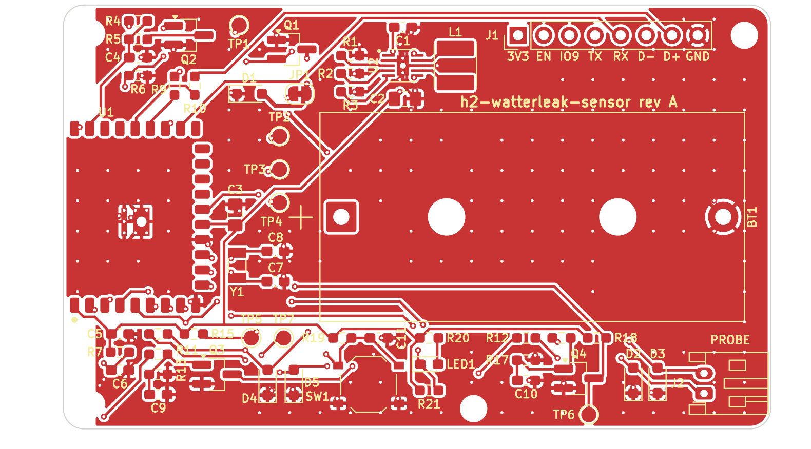
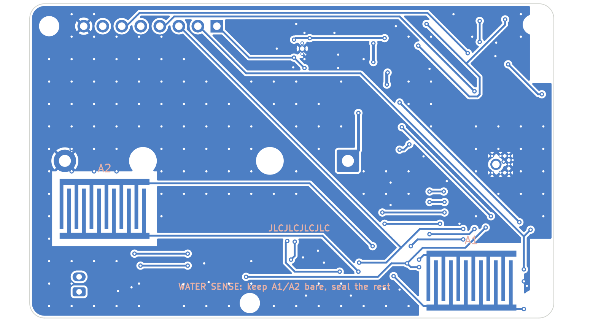
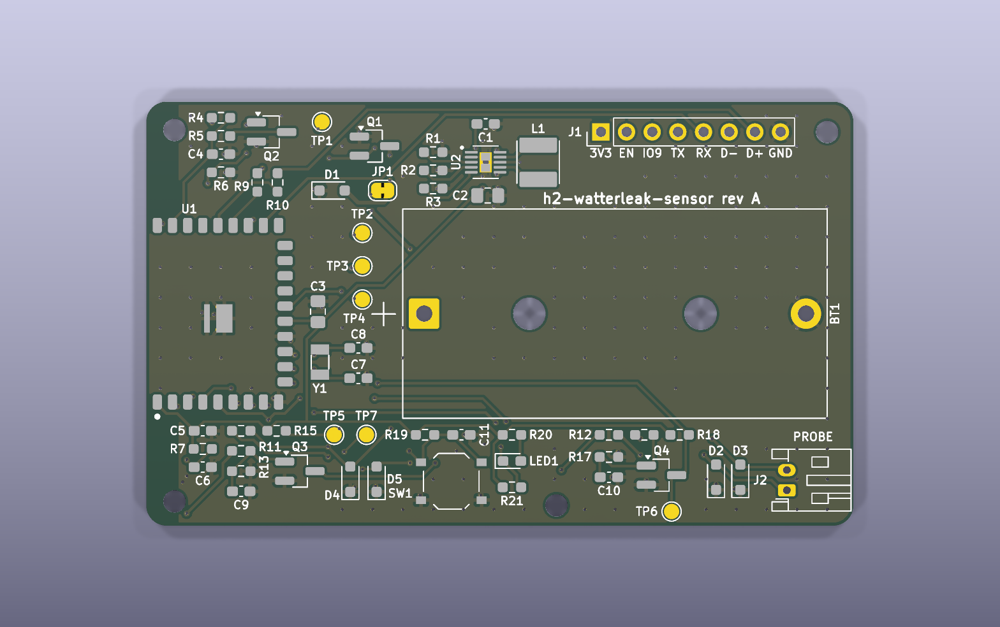
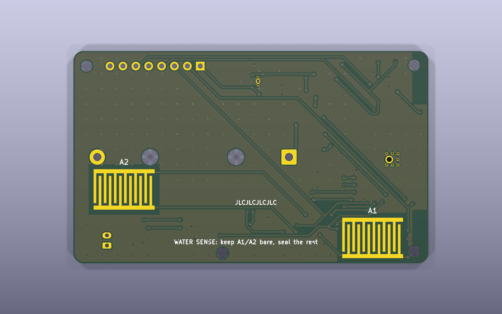
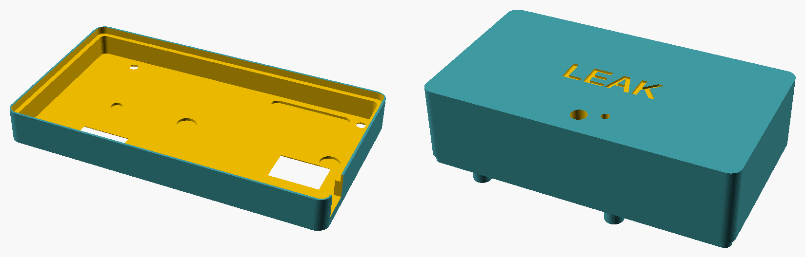

# Giai đoạn 4 — Layout PCB, DRC, file sản xuất và vỏ

> **Trạng thái:** HOÀN TẤT, chờ bạn duyệt trước khi sang GĐ5 (firmware).
> - Board 70 × 42 mm, 2 lớp, KiCad 9.0.9.
> - Linh kiện được đặt bằng script. Dây được đi bằng bộ router A* viết riêng (§1).
> - **KiCad DRC: 0 lỗi, 0 cảnh báo, 0 chỗ chưa nối, 0 lệch so với sơ đồ nguyên lý** (`kicad-cli pcb drc --severity-all --schematic-parity`).

## 0. Tệp

| Nội dung | Đường dẫn |
|---|---|
| Board KiCad 9 | [`hardware/h2-leak-sensor/h2-leak-sensor.kicad_pcb`](../hardware/h2-leak-sensor/h2-leak-sensor.kicad_pcb). Luật DRC và net class nằm trong `.kicad_pro`. |
| Gerber + drill (zip, tải thẳng lên JLCPCB) | [`hardware/h2-leak-sensor/fab/h2-leak-sensor_gerbers.zip`](../hardware/h2-leak-sensor/fab/h2-leak-sensor_gerbers.zip) |
| BOM / CPL định dạng JLCPCB | [`fab/h2-leak-sensor_bom_jlc.csv`](../hardware/h2-leak-sensor/fab/h2-leak-sensor_bom_jlc.csv), [`fab/h2-leak-sensor_cpl_jlc.csv`](../hardware/h2-leak-sensor/fab/h2-leak-sensor_cpl_jlc.csv) |
| Bản vẽ lắp ráp cho hàn tay | [`fab/h2-leak-sensor_assembly_top.pdf`](../hardware/h2-leak-sensor/fab/h2-leak-sensor_assembly_top.pdf), [`..._assembly_bottom.pdf`](../hardware/h2-leak-sensor/fab/h2-leak-sensor_assembly_bottom.pdf). Gồm lớp Fab, silkscreen và mép board, in đúng tỉ lệ 1:1. |
| Báo cáo DRC | [`fab/h2-leak-sensor_drc.json`](../hardware/h2-leak-sensor/fab/h2-leak-sensor_drc.json) |
| Ảnh | [`docs/img/pcb/`](img/pcb/): đồng mặt trên/dưới, render 3D trên/dưới |
| Vỏ in 3D | [`hardware/enclosure/`](../hardware/enclosure/): file OpenSCAD và 3 file STL |
| Script | `hardware/tools/gen_pcb.py` (đặt linh kiện, luật, vùng đổ, keep-out, silkscreen), `route.py` (đi dây), `fab_outputs.py` (xuất file) |

Tái tạo toàn bộ (cần KiCad 9 và Python 3 có `numpy`), khoảng 4 phút:

```sh
python3 hardware/tools/gen_pcb.py      # đọc netlist từ sơ đồ, đặt linh kiện, viết luật DRC
python3 hardware/tools/route.py        # đi dây + đổ GND + tự kiểm tra và sửa liên thông GND
python3 hardware/tools/fab_outputs.py  # Gerber, drill, BOM, CPL, PDF lắp ráp, báo cáo DRC
```

- `route.py --gnd-only`: chỉ kiểm tra và sửa liên thông GND trên board đã đi dây. Dùng sau khi bạn chỉnh tay.
- Thư mục `fab/gerber/` không được commit vì đã có trong file zip. Chạy `fab_outputs.py` sẽ tạo lại thư mục này.

## 1. Đi dây và DRC

### 1.1 Vì sao dùng router tự viết

Freerouting không chạy được trong môi trường làm việc của mình: chính sách an toàn chặn việc chạy file `.jar` tải từ Internet. Vì vậy mình viết `route.py`, dùng API Python `pcbnew` của KiCad, và lấy KiCad DRC làm thước đo cuối cùng.

Nếu bạn muốn so với Freerouting thì chạy trên máy bạn:
1. KiCad: **File → Export → Specctra DSN**.
2. Chạy Freerouting với file DSN đó.
3. KiCad: **File → Import → Specctra Session**.
4. Đổ lại vùng đồng (phím `B`), chạy DRC, rồi chạy `route.py --gnd-only` để kiểm tra GND.

### 1.2 Cách `route.py` làm việc

**Lưới và luật**
- Lưới 0,1 mm, căn đúng bội số 0,1 mm. Nhờ vậy chân bước 0,5 mm của TPS63900 nằm ngay tâm ô. Nếu lệch 0,05 mm thì dây 0,25 mm không lọt qua được khe giữa chân và pad tản nhiệt.
- 2 lớp, đi theo 8 hướng (góc 45°), đổi lớp bằng via 0,6/0,3 mm.
- Vật cản được lưu ở dạng hình học chính xác: đa giác pad, đoạn dây, đường tròn via/lỗ, keep-out, mép board.
- Ô bị cấm khi khoảng cách thật tới đồng khác net nhỏ hơn clearance + nửa bề rộng dây + 0,03 mm. Vì vậy dây đi ra luôn thoả luật 0,2 mm.
- Dây chỉ được vào hoặc ra pad ở những ô đủ khoảng cách. Ví dụ: không được vào đầu trong của chân TPS63900, chỗ sát pad tản nhiệt.

**Thứ tự đi dây**
1. GND của vòng công suất TPS63900 đi trước, bằng dây thật trên lớp trên (không chỉ dựa vào vùng đổ). Gồm U2.2, U2.8, pad tản nhiệt U2.11 (có lỗ xuống lớp dưới), GND của C1 (CIN) và C2 (COUT).
2. Tiếp theo là +3V3, rồi các net dài, cuối cùng là các net ngắn.
3. Net nào hỏng thì lượt sau được đi trước, tối đa 5 lượt. Bản hiện tại: lượt 1 hỏng CFG1 và LX2, lượt 2 đi đủ 36/36 net tín hiệu.

**GND**
- Mỗi pad SMD GND có một đoạn fan-out ngắn xuống via, nối vào mặt GND lớp dưới.
- Via khâu đặt bước 3 mm ở mọi chỗ trống. Đổ GND cả 2 lớp.
- Kiểm tra liên thông: union-find trên các đảo đồng đổ của cả 2 lớp cùng mọi pad/via/dây GND, xét đúng cách đồng chạm nhau. Cụm nào bị cô lập thì được nối lại theo thứ tự ưu tiên:
  1. đặt một via ở chỗ hai lớp chồng nhau;
  2. đi một dây GND ngắn;
  3. nếu cụm bị dây tín hiệu rào kín ở cả 2 lớp: gỡ một net tín hiệu bên cạnh, đi GND qua khe vừa trống, rồi đi lại net đó (rip-up & reroute).
- Cuối cùng xoá các đoạn dây GND thừa nằm trọn trong vùng đổ.

### 1.3 Kết quả

| Hạng mục | Số liệu |
|---|---|
| Net tín hiệu | 36/36 đã đi dây; GND nối bằng 2 lớp đổ đồng cùng dây và via |
| Dây | 276 đoạn, tổng 950 mm (F.Cu 455 mm, B.Cu 495 mm). Rộng 0,25 mm; riêng BAT_CELL và BAT_RAW rộng 0,4 mm. |
| Via | 234 via. 58 via cho tín hiệu. 176 via GND: 142 via khâu, phần còn lại là fan-out và via nối đảo. |
| Sửa liên thông GND | 3 cụm được nối lại (2 via và 1 dây ngắn). Đã xoá 14 đoạn GND thừa. |
| **KiCad DRC** | **0 lỗi, 0 cảnh báo, 0 chỗ chưa nối, 0 lệch sơ đồ** |
| Silkscreen | Ký hiệu linh kiện không đè pad, không sát mép board, không đè dấu cực tính. Riêng **R14 và R16** không còn chỗ trống nên ký hiệu chỉ có trên lớp Fab (xem PDF lắp ráp). |

Đồng mặt trên kèm silkscreen:



Đồng mặt dưới, nhìn từ phía dưới (đã lật gương):



Những điểm nên biết:
- **+3V3, LX1, LX2 rộng 0,25 mm** vì phải nối vào chân 0,25 mm của TPS63900. Đoạn LX dài khoảng 4 mm, điện trở ≈ 8 mΩ, nên sụt áp không đáng kể ở dòng đỉnh cuộn cảm. Nếu muốn, có thể nới rộng bằng tay các đoạn xa chân IC.
- **SNS_A dài khoảng 48 mm** vì kênh A nối song song hai điện cực A1 (góc trái-dưới) và A2 (đầu phải). Đây là nút trở kháng cao, nhưng đã có lọc 10 kΩ / 10 nF / 1 MΩ. Dòng rò bề mặt sẽ được kiểm tra trong bài thử nước ở GĐ6.
- Router ưu tiên đúng luật hơn thẩm mỹ, nên vài đường còn đi vòng. Bạn có thể chỉnh tay trong KiCad, miễn là DRC vẫn sạch và chạy lại `route.py --gnd-only`.

## 2. Thông số chế tạo (JLCPCB)

| Mục | Giá trị |
|---|---|
| Lớp / độ dày / đồng | 2 lớp, FR-4, **1,6 mm**, 1 oz |
| Bề mặt | **ENIG**. Bắt buộc, vì điện cực răng lược lộ đồng và tiếp xúc nước. HASL sẽ bị oxi hoá hoặc ăn mòn và không phẳng. |
| Solder mask / silkscreen | Xanh lá (hoặc tuỳ ý) / trắng |
| Kích thước | 70 × 42 mm, bo góc R2. Anten module chìa ra mép trái 6 mm. |
| Via | 0,6 / 0,3 mm, tented (mặc định của JLCPCB) |
| Đặt hàng | 5 tấm. Mục "Remove order number" chọn **Specify a location**: mặt dưới đã có dòng `JLCJLCJLCJLC` nằm giữa hai điện cực, nên mã đơn sẽ in đúng chỗ đó thay vì lên vùng điện cực. |

## 3. Luật DRC (`h2-leak-sensor.kicad_pro`)

| Luật | Giá trị | Ghi chú |
|---|---|---|
| Clearance (net class Default/Power) | **0,20 mm** | Năng lực JLCPCB là 0,127 mm. |
| Clearance tối thiểu toàn board | 0,15 mm | |
| Bề rộng dây | 0,25 mm (tín hiệu và +3V3) / 0,40 mm (BAT_CELL, BAT_RAW) | Bề rộng tối thiểu 0,15 mm. |
| Via | Ø0,6 mm, khoan 0,3 mm, vành ≥ 0,1 mm | |
| Đồng tới mép board | 0,30 mm | |
| Đồng tới lỗ / lỗ tới lỗ | 0,25 / 0,25 mm | |
| Chữ silkscreen | ≥ 0,8 mm, nét 0,15 mm | Cách mép board ≥ 0,4 mm, cách pad ≥ 0,2 mm. |

## 4. Bố trí (floorplan)



*Ảnh render chưa có thân linh kiện vì container không cài bộ model 3D của KiCad. Module ESP chỉ hiện các pad.*

| Vùng | Linh kiện | Lý do |
|---|---|---|
| Mép trái | U1 ESP32-H2-WROOM-02C, xoay 90° | **Anten chìa ra ngoài mép board 6 mm**, đúng cách bố trí Espressif khuyến nghị nhất. Footprint mang sẵn vùng keep-out cho phần anten. Hai góc trái (x < 3,2 mm) có keep-out đồng, via và vùng đổ. |
| Giữa–phải | BT1 (đế CR123A Bulgin BX0123) | Thân pin kim loại cách anten **≥ 25 mm** (khuyến nghị ≥ 15 mm). Phía dưới đế pin vẫn đi dây được ở cả 2 lớp. |
| Dải trên, trái | R4–R6, C4, Q2 (đo pin), R9/R10 (USB) | Sát chân 27/28 (IO1/IO0) và 23/24 (USB) của module. |
| Dải trên, giữa | JP1, D1, Q1, R1–R3, C1, U2, L1, C2 | Vòng công suất của TPS63900 ngắn: C1 sát VIN, L1 sát LX1/LX2, C2 sát VOUT. GND của C1, U2 và C2 nối bằng dây thẳng vào pad tản nhiệt. |
| Dải trên, phải | J1 (1×8, 2,54 mm) | Pin 1 = +3V3 ở bên trái. Silkscreen ghi tên từng chân ngay dưới chân đó. |
| Cột giữa module và pin | C3 (22 µF), Y1 + C7/C8, TP2–TP4 | C3 sát chân 14 (VBAT → 3V3). Thạch anh 32 kHz sát chân 11/12, dây ngắn, có GND bên dưới. |
| Dải dưới | C5, R7/C6 (EN); kênh A; SW1, LED1; kênh B; J2 | Front-end của mỗi kênh đặt gần đầu dò của kênh đó. J2 quay miệng ra mép phải. |
| Mặt đáy | **PRB1 (A1)** ở góc trái-dưới, **PRB2 (A2)** ở đầu phải dưới đế pin | Hai vùng 12×8 mm ở hai đầu board, nên nước tràn từ phía nào cũng chạm được. |
| Lỗ M2 | H1 (2,8; 2,8), H2 (2,8; 39,6), H3 (67,4; 3,0), H4 (40,6; 40,0) | Bắt vào trụ của nắp. Đặt lệch để chỉ lắp được một chiều. |

## 5. Điện cực mặt đáy



- **Hình học:** 2 vùng 12×8 mm, ngón 0,5 mm, khe 0,5 mm, sống lược 0,8 mm.
  - Footprint `h2leak:Electrode_Comb_12x8mm` gồm 2 pad custom (EXC, SNS).
  - Solder mask chỉ mở trên đồng, nên giữa các ngón vẫn có mask.
- **Keep-out quanh mỗi điện cực** (tạo trong `gen_pcb.py`):
  1. Không đổ GND trong vùng điện cực + 1 mm. Mép đồng GND gần nhất cách điện cực ≥ 1 mm và nằm dưới mask.
  2. Không đặt via trên toàn vùng điện cực + 0,6 mm, ở cả hai lớp. Lý do: lỗ via lộ ở mặt đáy sẽ hút nước lên mặt trên.
  3. Không cho dây khác net chạy giữa các ngón.
- Nhờ vậy, khi nước tràn chỉ nối EXC với SNS, không nối với GND. Điều này giữ đúng ngưỡng kích và tránh dòng rò qua GND.
- **Sau khi hàn:** phủ conformal coating (hoặc sơn móng tay hay epoxy) lên toàn bộ mặt đáy, **dán băng che hai vùng A1/A2 trước khi phủ**. Cắt chân THT còn ≤ 0,6 mm.

## 6. File sản xuất

| File | Ghi chú |
|---|---|
| Gerber | F/B.Cu, F/B.Mask, F/B.Paste, F/B.SilkS, Edge.Cuts. Lệnh xuất dùng `--subtract-soldermask` (silk không đè lên pad). Gốc toạ độ là góc dưới-trái board. |
| Drill | Excellon, tách PTH/NPTH, đơn vị mm, cùng gốc với Gerber. |
| BOM JLCPCB | Cột Comment, Designator, Footprint, LCSC Part #, MPN, Qty.<br>BOM được lấy từ chính board, nên tôn trọng cờ "Exclude from BOM".<br>**Không có module ESP** (theo yêu cầu), cũng không có điện cực, test pad, jumper và lỗ bắt vít.<br>Đế pin BX0123 và header J1 không có mã LCSC: mua ngoài và hàn tay. |
| CPL JLCPCB | Cột Designator, Mid X, Mid Y, Layer, Rotation. Chỉ gồm các linh kiện có trong BOM (48 linh kiện).<br>Bản này hàn tay nên CPL chỉ để dự phòng. Nếu nhờ JLCPCB lắp, **kiểm tra hướng ở bước xem trước của JLC**, vì SOT-23, SOD-323, LED và WSON đôi khi bị lệch 90° hoặc 180°. |
| PDF lắp ráp | Lớp Fab cộng silkscreen. Có cả ký hiệu R14/R16 không in được lên silkscreen. In 1:1 để so footprint với linh kiện thật. |

## 7. Vỏ in 3D

Xem [hardware/enclosure/README.md](../hardware/enclosure/README.md):
- Kích thước ngoài ≈ 82,5 × 46,4 × 29,2 mm, nhựa PETG hoặc ASA.
- Cửa sổ vát mép dưới hai điện cực, nên điện cực cách sàn ≈ 1,2 mm.
- Khe cho phích J2, chốt bấm cho SW1, lỗ dẫn sáng cho LED1.
- 4 vít M2 (dùng vít nylon ở hai lỗ gần anten).



## 8. Checklist trước khi đặt hàng

1. Mở `hardware/h2-leak-sensor/h2-leak-sensor.kicad_pro` bằng KiCad 9.
   - **Inspect → Design Rules Checker**, bật "Refill all zones" và "Test for parity between PCB and schematic".
   - Kỳ vọng: 0 lỗi, 0 cảnh báo, 0 chưa nối.
2. Mở 3D Viewer (`Alt+3`) và kiểm tra:
   - anten module chìa ra mép trái;
   - J2 quay miệng ra mép phải;
   - không có linh kiện nào dưới đế pin ngoài TP và dây.
3. In 1:1 file `fab/h2-leak-sensor_assembly_top.pdf` (tắt "fit to page"). Đặt linh kiện thật lên giấy để so footprint, nhất là các linh kiện sau:
   - đế pin **BX0123**: khoảng cách và đường kính chân;
   - **JST-PH S2B-PH-K**;
   - nút **TS-1187A**;
   - module **WROOM-02C**;
   - cuộn cảm **WPN4020H**.
4. Đặt mạch ở JLCPCB:
   - tải lên `fab/h2-leak-sensor_gerbers.zip`;
   - chọn 2 lớp, 1,6 mm, **ENIG**, 1 oz;
   - mục "Remove order number" chọn **Specify a location**;
   - trong trình xem Gerber của JLC, xác nhận mặt dưới có hai vùng răng lược hở mask.
5. Nếu nhờ JLC lắp linh kiện SMD:
   - tải lên BOM và CPL;
   - soát hướng xoay từng linh kiện ở bước xem trước;
   - U1, BT1, J1 tự hàn tay.
6. Khi nhận board, **trước khi lắp pin**:
   - đo xem +3V3, VBAT_P, BAT_RAW có chập xuống GND không;
   - hàn U2, L1, C1, C2, R1–R3 trước;
   - cấp 3,0 V từ nguồn có giới hạn dòng (khoảng 100 mA) vào TP1 (VBAT_P) và GND;
   - đo +3V3 = 3,3 V ở chân 1 của J1;
   - sau đó mới hàn module.
